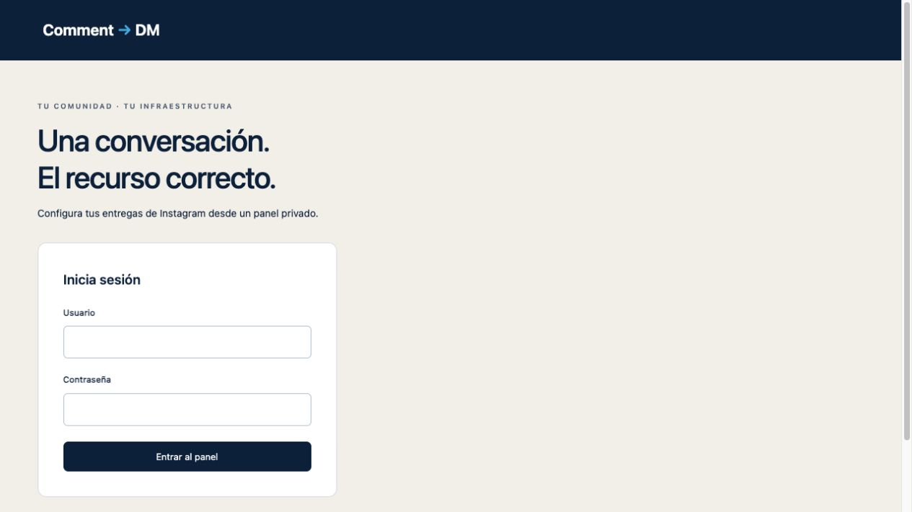
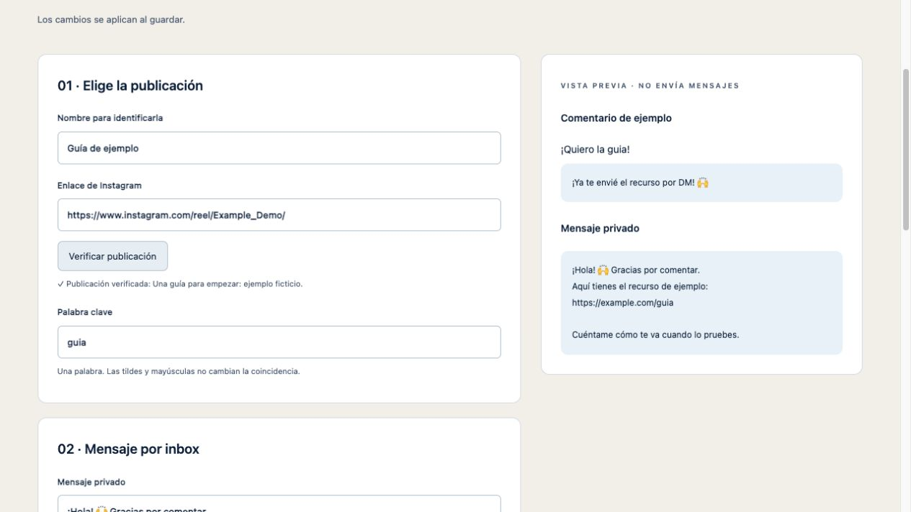
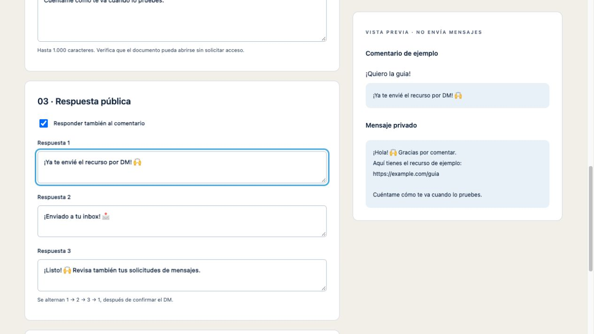
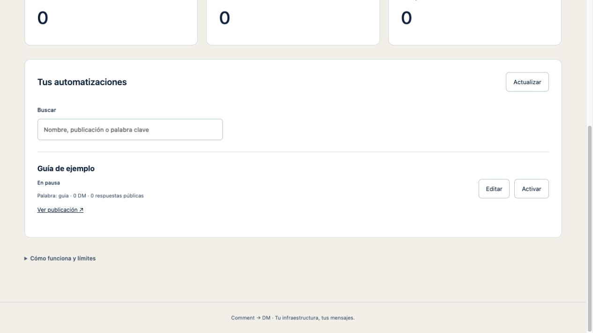

# Recorrido del panel

Todas las imágenes de esta página proceden del servidor local `tests/demo-server.mjs`, con cuenta, enlaces y mensajes ficticios. No muestran datos de una instalación real y no envían mensajes.

[Ver la demostración en video](demo.mp4) · 12 segundos, sin audio. El recorrido muestra acceso, publicación, respuestas y guardado en pausa.

## 1. Acceso privado

Cada instalación tiene su usuario y contraseña propios. No necesita iniciar sesión en ChatGPT para funcionar.

## 2. Publicación y palabra clave

Pega el enlace de una publicación de la cuenta conectada y pulsa **Verificar publicación**. Define una sola palabra clave; se normalizan mayúsculas y tildes.

## 3. Mensaje y respuestas

Escribe el DM con el enlace público al recurso y personaliza las tres respuestas públicas. La vista previa no envía mensajes.

## 4. Guardar en pausa

Revisa la configuración antes de activar. Puedes editar, activar y pausar desde la lista.

Para reproducir la interfaz de documentación, ejecuta `node tests/demo-server.mjs` y abre http://127.0.0.1:43877 . **Solo laboratorio en loopback**: usuario `demo`, contraseña `documentation-demo-only-password`. Son credenciales ficticias y públicas de esa demostración; no las uses en una instalación real.
